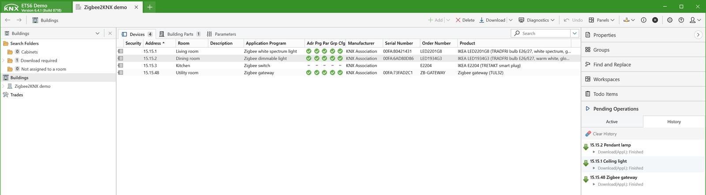

# zigbee2knx

Zigbee devices as KNX devices, with one gateway that is the Zigbee coordinator itself.

zigbee2knx is firmware for an ESP32-C6 with an NCN5130 KNX TP transceiver. The gateway forms its own Zigbee
network and turns every paired Zigbee device into a KNX device of its own: the device has its own individual address
and its own application with parameters and group objects in ETS, and you program it from ETS like any other KNX
device. No hub, no Home Assistant and no IP network sit in between. In operation the gateway needs nothing but the
KNX bus.

> **Status: preview (0.6).** Runs with IKEA lights and plugs and ETS 6.4.1. Not released for production
> installations yet; see [Status](#status).

## How it works

- **One KNX device per Zigbee device.** The gateway answers for up to 32 virtual KNX devices in its own line. It
  acknowledges their frames itself, so no coupler is needed.
- **Pairing from ETS.** When ETS programs an individual address in the gateway's range, the gateway opens the
  Zigbee network, and the first device that joins becomes that KNX device. A group object and the button on the
  gateway open a pairing window as well.
- **Device classes instead of device drivers.** A class (dimmable light, white spectrum light, switch/plug, remote)
  is one KNX application with its parameters and group objects, plus a small [Berry](https://github.com/berry-lang/berry)
  program that maps KNX to Zigbee. The models a class serves and their quirks come from the device definitions of
  [Zigbee2MQTT](https://github.com/Koenkk/zigbee-herdsman-converters), distilled into KNX functional blocks.
- **The behaviour travels with the product data.** The Berry program is embedded and signed in the parameter segment
  of the application. An ETS download brings it into the gateway, so a new device type needs no firmware update. The
  gateway runs only programs whose signature it trusts.

## Concept

**The firmware is generic; the devices are data.** The firmware knows Zigbee (the gateway is the coordinator), KNX
(the link and a device server for the virtual devices) and [Berry](https://github.com/berry-lang/berry), a small
scripting language. It knows no Zigbee device model. What a device is and how it behaves comes from its product
file: a device class is a KNX application, and its behaviour is a Berry program inside that application's parameter
segment. When ETS downloads the application, the program comes along; the gateway checks its signature, loads it and
runs every device of the class with it. The variety of supported devices therefore lies in the `.knxprod` files, not
in the firmware of the ESP32-C6.

Describing devices as Berry templates is the approach of [BREMA](https://github.com/tostmann/BREMA), a rule engine
for KNX and radio sticks that handles its devices the same way; zigbee2knx carries it into KNX product data.

**Compared with Zigbee2MQTT.** [Zigbee2MQTT](https://www.zigbee2mqtt.io/) supports a device through a converter, a
piece of JavaScript in zigbee-herdsman-converters or loaded as an external converter, which runs on the host next to
the Zigbee stack. zigbee2knx distils those device definitions into KNX classes and products: models that behave
alike share one class, and what differs between them is a table in the class's Berry program.

| | Zigbee2MQTT | zigbee2knx |
|---|---|---|
| Support for a device lives in | a converter in the host software | a Berry program inside the KNX product file |
| A device it does not know yet needs | a converter | a product file, imported into ETS |
| Configured with | its web front end and MQTT | ETS: parameters and group objects |
| Runs on | a host with a Zigbee adapter | the gateway alone, on the KNX bus |

**More devices: contributions welcome.** Support for further devices depends almost only on product files.

- Another model of an existing class (another lamp that is a dimmable light, another plug) is only a catalog
  product: `distill/knxprod_products.py --append` adds it without touching the signed program, so anybody can build
  and import such a file.
- A new class (a kind of device not covered yet) is a manifest and a Berry program under [`templates/`](templates/),
  tested in the host VM ([`tests/`](tests/)). Send it as a pull request: once reviewed, it is signed with the
  project's release keys and goes out in a product file that every gateway accepts.

[docs/templates.md](docs/templates.md) describes a class, [docs/building-knxprod.md](docs/building-knxprod.md) the
product files.

**Why the programs are signed.** Berry is no sandbox: a program in the gateway can do what the firmware can, on the
KNX bus and in the Zigbee network. So the gateway runs only programs signed with a key compiled into its firmware. For
the images of this project these are the release keys, whose private halves were created in memory only, burned into
two hardware keys and then destroyed. A product file whose program was changed or comes from someone else is refused,
and the download ends with an error in ETS: importing a product file from an unknown source cannot bring code into an
installation. Products added to an existing class keep the signed program as it is and need no key. Whoever wants to
run programs of their own builds the firmware with their own key
([docs/templates.md](docs/templates.md#templates-of-your-own)). This signature is not the one ETS checks on a
`.knxprod`: that one covers the product data for ETS; the program's signature protects the gateway.

## In ETS

The device classes in the catalog, one product per model:

A gateway, two lights and a plug, each a KNX device with its own individual address and application (serial numbers
blanked out):

Pairing from ETS: while ETS programs the address 15.15.3, the plug joins the Zigbee network and takes the address
(group monitor below):

The group objects of a white spectrum light, linked like those of any KNX actuator:

The gateway's diagnostic objects with their last values:

The title image is an illustration; the laptop shows a real ETS screenshot.

## Hardware

Runs best with the busware **TUL32** (KNX TP, powered over USB) and the bus-powered **TULX32** ([Status](#status) lists what has been tested on each): <https://busware.de>.

Other ESP32-C6 boards with an NCN5130 need their pins in [`firmware/main/board.h`](firmware/main/board.h).

## Getting started

1. **Flash the firmware** from the browser with the [web installer](https://tostmann.github.io/zigbee2knx/) (Chrome,
   Edge or Opera; TUL32 only), or with esptool from the images attached to the [releases](../../releases); to build it
   yourself see [docs/building-firmware.md](docs/building-firmware.md). On a TULX32 do not use the web installer, it
   would overwrite the bootloader and the partition table: write only the application,
   `zigbee2knx-<version>-tulx32.bin`, at 0x10000 with esptool over the service header. Read the whole flash first
   (`esptool read-flash 0 0x400000 backup.bin`): this replaces the application the TULX32 was delivered with, and the
   way back through its recovery system has not been tested.
2. **Build the product files** with OpenKNXproducer and your ETS, as described
   [below](#building-the-product-files), and import them into ETS.
3. **Add the gateway.** Insert "Zigbee gateway (TUL32)", the product for both boards, into a line, program its
   individual address (button S1), set the range of device numbers for Zigbee devices and download it. Keep that range
   free of other KNX devices: the gateway takes every address ETS programs in it as a request to pair a Zigbee device.
4. **Add a Zigbee device.** Insert its product (for example "IKEA LED1934G3 …") into the same line with an address in
   that range (by default 200 to 231) and program the individual address. While ETS waits, reset the Zigbee device or put it into pairing
   mode: it joins and takes the address. Then download the application and link the group objects.

[docs/getting-started.md](docs/getting-started.md) has the details, the gateway's objects and the known limitations.

## Building the product files

ETS takes devices from `.knxprod` files, and a `.knxprod` has to be signed by the signing library of an ETS. This
repository holds the source of the product files in [`producer/`](producer/), one XML file per device class.
[OpenKNXproducer](https://github.com/OpenKNX/OpenKNXproducer) turns them into `.knxprod` files with the ETS installed
on your PC:

1. On a Windows PC with ETS installed, download OpenKNXproducer from its
   [releases](https://github.com/OpenKNX/OpenKNXproducer/releases).
2. Copy the XML files from `producer/` into a folder and run OpenKNXproducer there, once per file:

       OpenKNXproducer create zigbee-gateway
       OpenKNXproducer create zigbee-dimmable-light
       OpenKNXproducer create zigbee-white-spectrum-light
       OpenKNXproducer create zigbee-switch
       OpenKNXproducer create zigbee-remote

   Each run checks the file and writes `<name>.knxprod` next to it.
3. Import the `.knxprod` files into the ETS catalog. The products appear under KNX Association → Zigbee2KNX, in the
   sections Gateway, Lights, Plugs and switches and Remotes.

The files use M-00FA, the manufacturer ID of the KNX Association, as open-source KNX projects do; they are not
registered with the KNX Association. Two builds of the same XML, with OpenKNXproducer 4.3.12 and the signing library
of ETS 6.4.1, gave the same applications, so product files built on different PCs can be used side by side; other
versions of the signing library have not been compared.
[docs/building-knxprod.md](docs/building-knxprod.md) covers adding products and new application versions.

## Supported devices

| Application | Class | Products |
|---|---|---|
| 0xC000 | Zigbee gateway | the gateway itself |
| 0xC001 | dimmable light | 23 IKEA products (23 Zigbee2MQTT definitions) |
| 0xC002 | white spectrum light | 48 IKEA products (35 Zigbee2MQTT definitions) |
| 0xC003 | switch and plug | 14 IKEA products (4 Zigbee2MQTT definitions) |
| 0xC004 | remote (experimental) | 6 IKEA products (6 Zigbee2MQTT definitions) |

One Zigbee2MQTT definition can stand for several products: the white-label names and order numbers of the same device.
Each class also has a generic product. A model the class does not list runs with the class defaults; the gateway
reports it. The full list is in [docs/devices.md](docs/devices.md).

Why IKEA? For a start, just because those devices were lying around on the bench — no dedication :-) Other makes are
welcome, see [Concept](#concept).

## Status

What has run with ETS 6.4.1 on a TUL32 with development builds of 0.6.1: import of the product files in `producer/`
(0xC000 v4, 0xC001 v5, 0xC002 v6, 0xC003 v4), and updating and downloading the devices of a project, in two steps
from the versions of 0.6.0. After the update to 0xC002 v6 that light did not run until the gateway was restarted; the
cause is fixed in 0.6.1, and the fix was tested with a bench tool, not again with ETS. From a bench tool over a
KNXnet/IP tunnel, with the image of release 0.6.1 on the same TUL32: switching, dimming and colour temperature with
status feedback, the gateway's diagnostic objects, downloads with long frames, updates of the white spectrum light in
place, and the applications of 0.6.0 (0xC001 v3, 0xC002 v4, 0xC003 v3) loaded by downloads, 0xC002 v4 also at a
restart. With 0.6.0 and its applications, from ETS: import of a project, pairing a plug, and switching, brightness and
colour temperature with status feedback in the group monitor. With earlier development builds of 0.6:
partial downloads, the "Zigbee device reachable" object in both directions, and unloading an address (the device is
removed and asked to leave the Zigbee network). With development builds before 0.6: programming the gateway's address
with its button S1, and inserting devices from the catalog. Devices on the bench: IKEA LED1934G3, LED2201G8 and E2204.

On a TULX32, powered from the bus, a development build of 0.6.1 ran a two-hour load test with an IKEA plug that had
joined through the pairing window: switching with status feedback, reading, eight downloads, four of them with long
frames, no restart. The image of release 0.6.1 started there, formed its network and, without a Zigbee device joined,
took downloads from a bench tool instead of ETS: the gateway's application, then the plug and the white spectrum light
applications with long frames (the latter seven times, no restart). On the TULX32 the firmware caps the Zigbee
transmit power at 18 dBm: at 20 dBm the bus supply did not hold while the radio sent. Not tried on the TULX32: ETS
itself, pairing from ETS, the button S1, and the way back through its recovery system; its bus current with Zigbee
running has not been measured.

Not done yet: pairing from ETS with 0.6.1 (last run with 0.6.0; the pairing window ran with development builds of
0.6.1), the pairing window opened by the gateway's button, the remote class with ETS, long frames through line couplers
and USB interfaces, ETS with a TULX32 (see above), and installations with more than a few real Zigbee devices. Known
issues are listed in [docs/getting-started.md](docs/getting-started.md#known-limitations).

## Questions and issues

Questions, ideas and reports of what runs go to [Discussions](../../discussions); bugs and requests for new
devices to [Issues](../../issues/new/choose). Report security problems privately, see [SECURITY.md](SECURITY.md).

## Repository

| Directory | Content |
|---|---|
| `firmware/` | ESP-IDF project: Zigbee coordinator, KNX link layer and device server, Berry VM, host tests |
| `templates/` | the device classes: `manifest.json` (KNX application, Zigbee mapping) and the Berry program |
| `producer/` | the KNX product data as OpenKNXproducer input, one file per class, with the program embedded |
| `berry/` | host API of the templates (`prelude.be`, `PROTOCOL.md`) and the host VM for the tests |
| `distill/` | Zigbee2MQTT definitions to classes and product lists |
| `tools/` | product data generator and the signed template container (KGT2) |
| `tests/` | template tests in the host VM, product list tests |
| `docs/` | building, getting started, templates, device list |

## License

GPL-3.0-only, with an additional permission under section 7 for linking with Espressif's libraries that come in
object code form (see [NOTICE.md](NOTICE.md)). Third-party parts and their licenses are listed there as well.

zigbee2knx is not affiliated with or endorsed by the KNX Association, the Connectivity Standards Alliance, IKEA or the
Zigbee2MQTT project. Product names are used only to identify the devices.
